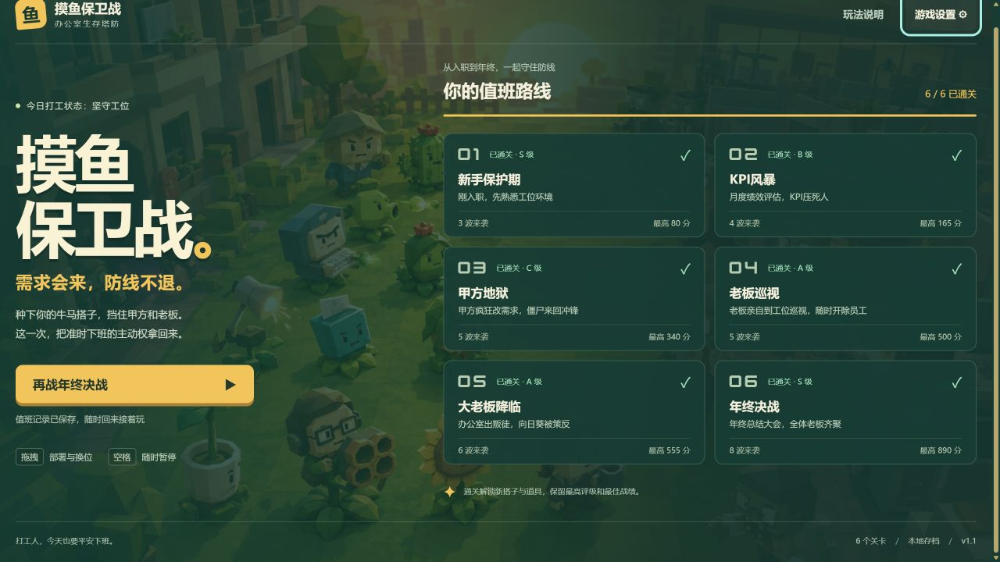
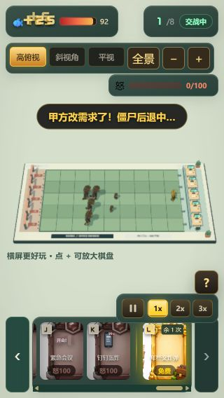
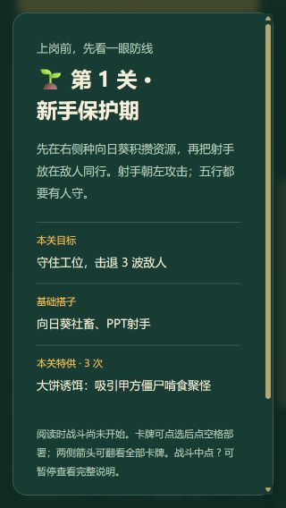
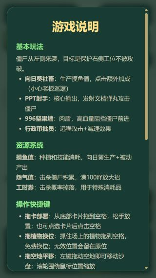
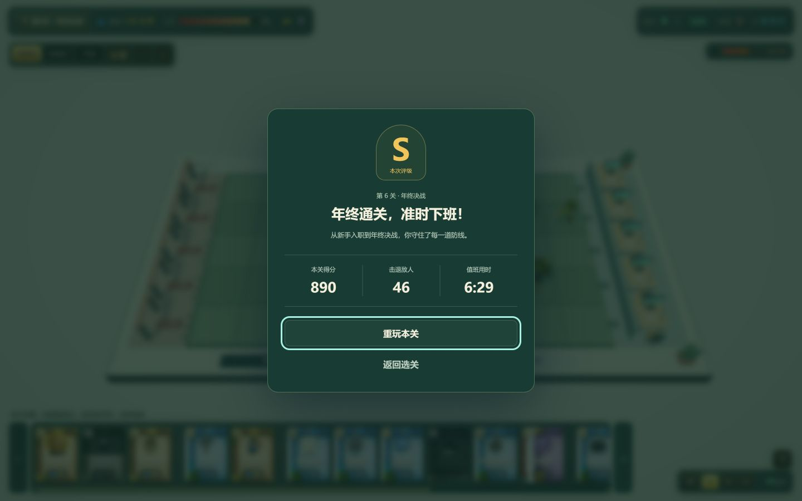

# 摸鱼保卫战

一款围绕办公室生存展开的 Three.js 3D 塔防游戏。部署向日葵社畜与 PPT 射手，挡住从左侧来袭的甲方、KPI 和老板，保护右侧工位，逐关挑战直到年终决战。



## 项目预览

- **完整六关战役**：从新手保护期到年终决战，逐关解锁搭子、技能和特供道具。
- **自由调度的 3D 棋盘**：拖卡或点选部署，免费移动已有植物，支持平移、缩放、视角复位与键盘部署。
- **开战前简报**：先了解本关威胁、新道具和目标，再开始倒计时。首关提供分步部署提示。
- **手机布局**：适配窄屏与小尺寸横屏；卡牌两侧提供翻页箭头，17 张卡牌均可找到。
- **默认静音、本地存档**：暂停、设置、通关评级、最高纪录及异常恢复均有独立流程。

| 手机战斗与卡牌翻页 | 开战前简报 | 游戏帮助与主题滚动条 |
| --- | --- | --- |
|  |  |  |

以上为内置浏览器中的实际游戏截图。完整战斗和最终结算见下文。

## 本地开发

要求 Node.js **22.12+**，建议使用当前 Node.js 22 或 24 LTS。

```bash
npm ci
npm run dev
```

访问 `http://localhost:5179/`。开发服务默认只监听本机，且不会自动打开系统浏览器。

```bash
npm test         # 游戏交互、关卡、存档、资源释放及时间步回归
npm run build   # 构建 dist/
npm run preview # 在 http://localhost:4173/ 验证正式构建
```

## 第一次值班

1. 选关并阅读简报，点击“开始本关”后才开始计时。
2. 先把向日葵放在右侧后排，逐步建立 2–3 棵的经济来源。
3. 来敌后，在同一行部署射手。敌人向右走，射手朝左打；后续逐步覆盖五行。
4. 坚果放在输出左侧，审批员负责减速。某一行受压时，拖动已有植物免费补防。
5. 用咖啡恢复工位，留意老板蓄力与 KPI 扣款。最终关可保留年终奖炸弹应对首领。

卡牌不足时可等待生产；卡牌置灰时查看费用和冷却。手机可先点卡再点空格，横向滑动或使用两侧箭头浏览卡牌。点 `?` 阅读帮助时，战斗暂停。

| 关卡 | 主要压力 | 新的应对重点 |
| --- | --- | --- |
| 1 · 新手保护期 | 甲方分路进攻 | 经济、同行输出、免费换位 |
| 2 · KPI 风暴 | KPI 持续扣款 | 优先集火，坚果与换鱼锤 |
| 3 · 甲方地狱 | 频繁后退与冲锋 | 审批减速，补齐五行 |
| 4 · 老板巡视 | 老板蓄力开除植物 | 打断、补防、咖啡救急 |
| 5 · 大老板降临 | 向日葵被策反 | 分散经济，利用应急日报 |
| 6 · 年终决战 | 多老板与最终首领 | 完整阵容、怒气技能、保留特供 |

## 游戏规则

- 棋盘为 5 行 × 9 列。敌人从左向右进攻；射手向左攻击同一行的敌人。
- 每关完成所有波次且工位生命仍大于 0 即可通关。工位归零时失败，可重试。
- 摸鱼值可以因随机事件短暂透支；透支时等待被动产出或向日葵生产恢复。
- 向日葵：25 摸鱼值，每 5 秒生产 25。点击额外收取 8，但可能触发老板巡视。
- PPT 射手：75 摸鱼值，自动攻击；原地长按 0.6 秒可蓄力，发射需消耗 40 摸鱼值。
- 坚果墙、行政审批员及其他道具在完成对应关卡后逐步解锁。第 6 关可使用三种终极技能。
- 本关特供道具显示剩余次数；重试时恢复次数。
- 工时券在通关后入账并跨关保留；失败重试不会累积本局临时奖励。
- 牛头事件提供 12 秒选择时间，出现时自动回到 1 倍速，选择期间不能加速；打开帮助、设置或暂停菜单会暂停战斗。

## 操作

| 操作 | 方式 |
| --- | --- |
| 部署 | 拖卡到空格后松手，或点选卡牌再点格子 |
| 浏览卡牌 | 左右箭头、横向滚动；触屏滑动卡牌栏 |
| 换位 | 拖动已部署植物到空格，免费并保留生命与进度 |
| 平移 / 缩放 | 拖动空地 / 滚轮，触屏可点 `−` 与 `+` |
| 旋转 / 复位 | 右键拖动 / 点“全景” |
| 选卡 | 卡牌角标显示的 Q、W、E 等快捷键 |
| 键盘部署 | Tab 聚焦棋盘，方向键选格，选卡后按 Enter 部署 |
| 取消 | Esc、右键或“取消”按钮 |
| 暂停 / 继续 | 空格、Esc 或暂停按钮；按钮聚焦时空格执行该按钮 |
| 速度 / 视角 | 1、2、3 切换倍速；C 切换视角 |

切换标签或窗口时战斗自动暂停，返回后手动继续。手机建议横屏游玩；横屏棋盘自动移到右侧，避开卡牌。可随时缩放或恢复全景。

## 设置与存档

首次启动默认**静音**，不会创建音频上下文。可在大厅或暂停菜单打开设置，调整音效、自动/精细/省电画质，以及减少动态效果。减少动态效果默认跟随系统偏好。

最高评级、最高得分、最佳成功用时、最高击杀数、通关次数及关卡解锁自动保存在当前浏览器。旧版解锁进度自动迁移；损坏数据会安全回退。浏览器拒绝存储时仍可游玩，并显示无法保存的提示。

存档不包含进行中的战斗。清除站点数据会清除记录；不同浏览器、域名或端口的存档相互独立，无云端同步。

## 发布

1. 执行 `npm ci`、`npm test`、`npm run build`。
2. 将 **dist 目录内容**上传至静态站点托管服务。不要部署开发服务器。
3. 开启 HTTPS 与 Brotli/gzip。`assets/` 中带哈希的文件可长期缓存，`index.html` 使用重新验证缓存策略。
4. 保留全部 GLB、图片、字体和 JS 资源；服务器应正确提供 `.glb` 文件。

构建使用相对资源路径，支持部署在子目录。支持具有 WebGL 的现代 Chrome、Edge、Firefox 和 Safari；尚未执行所有真机浏览器的兼容性验证。

启动失败时显示重新加载入口；模型加载失败时使用程序化角色，并允许后续部署重试。WebGL 上下文丢失时暂停战斗，恢复后重建画面。角色模型按关卡预加载，选关界面与后台页面停止持续 3D 渲染。

Three.js 引擎单独打包缓存，目前约 570 KB（gzip 约 145 KB）；构建会给出大包提示。现有高精度 GLB 仍为 1–2.6 MB/个，弱网首次加载可继续使用程序化角色。

GitHub Actions 会在 push 和 PR 时执行测试与正式构建，并保留 dist 构建产物 14 天。

## 通关与难度验证

完整记录见 [关卡通关与难度平衡报告](docs/balance-report.md)。原始逐局数据位于 `tests/reports/`，回归检查会验证其源码指纹、六关覆盖、结算、存档、快捷键及连续战役结果。

2026-11-17 已在内置浏览器按正常玩家流程手动完成六关，评级依次为 **S / B / C / A / A / S**，最终关剩余 90% 生命。逐关成绩、操作路径、手机适配问题与修复复核见 [手动试玩记录](docs/manual-playtest.md)。试玩全程静音，使用正常费用、冷却和游戏内倍速，没有改写存档、资源或生命。



手机验证使用内置浏览器的 320×568 竖屏和 667×375 横屏等视口；触屏卡牌滚动另外有输入回归测试。它不等同于 iOS/Android 真机、软键盘、安全区、触控硬件或屏幕阅读器的完整兼容性认证。

需要复测时运行开发服务，在内置浏览器打开 `http://localhost:5179/?balance`，选择 10 个种子和“修复后复测”，分别执行种子复现、全部关卡与连续通关。实验室始终静音，使用真实战斗逻辑和隔离存档；不进入正式构建。每次完成战役后，可关闭最终结算再启动下一批测试。

```bash
node tools/summarize-balance.mjs # 从当前源码对应的浏览器报告生成汇总
```

报告中的自动策略胜率用于回归对比，不等同于真实玩家通关率。

## 代码结构

```text
src/bootstrap.js                 启动错误边界
src/main.js                      游戏生命周期与场景编排
src/systems/LevelSystem.js       波次推进、结算、解锁
src/systems/PlayerStorage.js     校验、迁移、存档与设置
src/systems/InteractionSystem.js 射线拾取、鼠标/触屏/键盘部署
src/systems/BoardGestures.js     拖放与换位事务
src/ui/                         大厅、HUD、设置与结算
src/entities/                   植物、敌人与弹丸
src/utils/Simulation.js         固定时间步
src/utils/ProjectileCollision.js 弹丸连续碰撞
src/utils/disposeObject.js      GPU 资源释放
src/production.css              大厅与共享面板视觉、响应式适配
tests/                          Node.js 原生测试
```

`vite.config.js` 中 `UNLOCK_ALL_LEVELS` 默认关闭，正式版本按进度解锁。调试棋盘工具只在开发环境添加 `?debug` 时启用。素材来源见 [ASSET_SOURCES.md](ASSET_SOURCES.md)。
